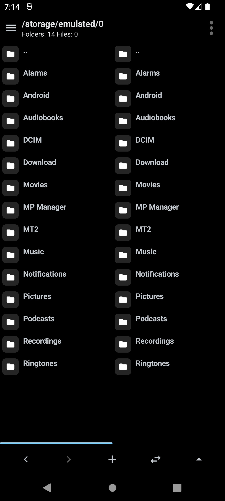
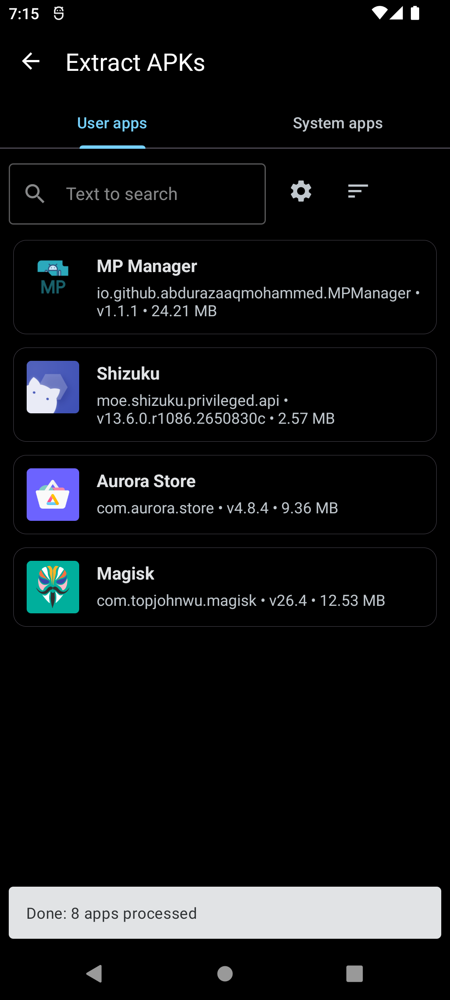

#  MP Manager

A free dual pane, Material Design file manager for Android with focus on APKs and the goal to be an open source alternative to MT Manager

   

MP Manager can browse and manage local, root and network storage in two panes and supports a variety of APK functions; signing, decompiling, DEX, resource editing, patching and dumping. Full documentation with screenshots is available on the [website](https://abdurazaaqmohammed.github.io/mpmanager.html).

## Features

| Area | Highlights | Docs |
|---|---|---|
| File Manager | Dual pane navigation, advanced search (including inside archives), archives browsed as folders (ZIP, RAR, zst, backups), recycle bin, checksums, root / Shizuku / Dhizuku access | [File Manager](https://abdurazaaqmohammed.github.io/mpmanager/file-manager.html) |
| Network | FTP server and client with FTPS, WebDAV and SMB clients, server discovery, encrypted saved profiles | [Network](https://abdurazaaqmohammed.github.io/mpmanager/network.html) |
| Media | Audio and video player with background mini player, image editor, EXIF editing, Free Style collage studio | [Media](https://abdurazaaqmohammed.github.io/mpmanager/media.html) |
| APK Tools | Install and sign APKs, decompile and build, dex and ARSC editors, manifest quick edit, LSPatch integrated mode, IL2CPP dumper, Jiagu unpacker, native library patcher | [APK Tools](https://abdurazaaqmohammed.github.io/mpmanager/apk-tools.html) |
| Editors | Text editor with syntax highlighting and AXML decoding, hex editor, compare text, archives, resources and dex files | [Editors](https://abdurazaaqmohammed.github.io/mpmanager/editors.html) |
| Tools | Command Shell, Smart App Ops, SetEdit, SQLite viewer and editor, partition dumper, boot image tools, ARM64 disassembler, Logcat reader, OCR, plugins and tool packs | [Tools](https://abdurazaaqmohammed.github.io/mpmanager/tools.html) |
| AI and MCP | Built-in MCP server: let AI tools drive the app's file, ZIP and APK engines with a strict access policy | [AI and MCP](https://abdurazaaqmohammed.github.io/mpmanager/ai-mcp.html) |

## Download

Grab the latest APK from [Releases](https://github.com/AbdurazaaqMohammed/MP-Manager/releases). Minimum Android version is 6.0.

## Contributing

Pull requests are welcome. To extend MP Manager, start with the [third-party plugin guide](docs/THIRD_PARTY_PLUGINS.md) and the [standalone plugin template](samples/plugin-template/). Plugins can be built in their own repositories using the small [plugin SDK](plugin-sdk/); no host signing key or in-process code loading is required.

## Translations

The app is translated to Russian, Simplified Chinese, Spanish, Indonesian, Arabic, Persian, Thai, Turkish and Vietnamese. New translations are welcome via pull request.

## Why is AI used to develop MP Manager?

I had the idea for MP Manager almost 10 years ago and I planned and developed it for years with little progress. I did not even post it on GitHub for a long time because the app barely worked at all. With AI, I was able to advance the app massively in a short time.

While some people use arguments like "AI only helps unskilled people" as insults, I believe MP Manager is an example of how AI can be used by regular people to create working alternatives to paid/closed source software. Big corporations love AI because they can save huge money from it, but they **want you and me** to hate AI because it allows regular people to not only save money, but create our own alternatives catered to our needs.

So far I didn't spend any money on AI in development of MP Manager. You can use AI to directly contribute to the development of MP Manager yourself.
Some free AI services have referral program that can give me more free usage, you can help me by sign up for these programs with my referral code/link:
  * [AgentRouter](https://agentrouter.org/register?aff=STIB) gives 175$ credit for GPT6.1 Sol
    * Just login with GitHub, you can use it in OpenCode or other programs
      * You can use OpenCode in termux https://github.com/bd-loser/opencode-bionic or https://github.com/Hope2333/opencode-termux
  * [WorkBuddy](https://workbuddy.ai/invite?code=KGGFX6GZ) gives free monthly credits and limited free promotions with models like DeepSeek 4.1 Flash, GLM5.3 Flash, MiniMax M3.1 Flash and more available.
    * You have to download the program and send at least one message (no charge) for me to get credits.
  * [ZCode](https://zcode.z.ai/invite/CW3JK87H) offers GLM 5.3/Flash with regular free promotions like 500 million free tokens on weekends.
    * You have to download the program and complete onboarding (no charge) for me to get credits.
* If the app gets more pull requests it may become eligible for the free [Claude for Open Source](https://claude.com/contact-sales/claude-for-oss) program

## License

MP Manager is licensed under the [GNU GPL v3](LICENSE).
